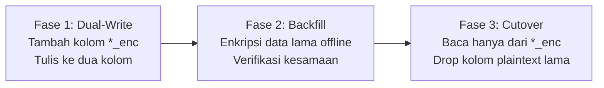

# Rancangan Enkripsi Selektif Kolom Database & Rencana Migrasi Bertahap

> **PERINGATAN PENTING**: Dokumen ini adalah USULAN RANCANGAN TEKNIS.
> **TIDAK ADA PERUBAHAN SKEMA / EKSEKUSI DDL DI POSTGRES** yang dilakukan sebelum konfirmasi eksplisit dari pengguna.

---

## 1. Audit Kolom Bisnis Sensitif di Database Postgres

Berdasarkan audit skema PANDU saat ini, kolom-kolom yang memuat data operasional dan rahasia bisnis yang diusulkan untuk dienkripsi di rest:

| Tabel | Kolom | Tipe Saat Ini | Sensitivitas Bisnis |
| :--- | :--- | :--- | :--- |
| `inspections` | `measurements` | `JSONB` | **Tinggi** (Parameter & angka hasil uji mutu laboratorium) |
| `inspections` | `notes` | `TEXT` | **Tinggi** (Catatan temuan cacat, deviasi, opini teknis) |
| `inspections` | `specification_snapshot` | `JSONB` | **Sangat Tinggi** (Toleransi standar mutu, resep spesifikasi produk) |
| `materials` | `attributes` | `JSONB` | **Tinggi** (Karakteristik teknis formula material) |
| `batches` | `attributes` | `JSONB` | **Sedang** (Metadata batch internal, nomor lot gudang) |

---

## 2. Format Penyimpanan Ciphertext Envelope

Setiap kolom terenkripsi disimpan dalam format JSONB terstruktur standar kriptografi (*Cryptographic Envelope Container*):

```json
{
  "v": 1,
  "alg": "AES-256-GCM",
  "iv": "a1b2c3d4e5f6789012345678", 
  "tag": "e1f2a3b4c5d6e7f8a9b0c1d2e3f4a5b6",
  "data": "k8X2...base64Ciphertext...",
  "kid": "odk-org-uuid-001"
}
```
* **Kunci Enkripsi Organisasi (ODK / Organization Data Key)**: Dikelola per-organisasi, dibungkus (wrapped) oleh KEK Master milik owner atau disimpan di KMS (AWS KMS / GCP Cloud KMS / HashiCorp Vault).
* **Integritas Otentikasi (AEAD)**: Tag autentikasi 128-bit menjamin ciphertext tidak dapat dimanipulasi di tingkat disk atau database.

---

## 3. Penanganan Pencarian & Filtering (Blind Indexing)

### 3.1 Tantangan
Postgres tidak dapat menjalankan query JSON path seperti `WHERE measurements->>'status' = 'FAIL'` pada payload terenkripsi.

### 3.2 Solusi Blind Index Token
Untuk kolom atau atribut yang memerlukan filtering atau pencarian kesamaan:
1. Hitung token pencarian deterministik ber-salt (*Blind Index*):
   $$\text{SearchToken} = \text{HMAC-SHA256}(\text{NormalizedValue}, \text{OrgSearchPepper})$$
2. Simpan token ini pada kolom indeks terpisah, misalnya:
   `notes_search_tokens text[]` atau `attribute_tokens jsonb`.
3. Query filtering dilakukan melalui pencocokan token hash tanpa membocorkan nilai teks asli ke mesin database atau database administrator.

---

## 4. Dampak Terhadap Row Level Security (RLS) & Query Engine

1. **Row Level Security (RLS)**:
   - **TETAP BERJALAN 100%**: Kebijakan RLS di Supabase mengevaluasi kolom otorisasi baris (`organization_id = auth.uid()` atau relasi keanggotaan `organization_members`).
   - Karena kolom `organization_id` **tidak dienkripsi**, evaluasi RLS oleh kernel Postgres tetap optimal dan tidak terganggu.
2. **Pertahanan Berlapis (*Defense in Depth*)**:
   - Lapisan 1: RLS membatasi akses baris per pengguna/organisasi.
   - Lapisan 2: Enkripsi kolom melindungi data jika terjadi pembobolan snapshot database, dump cadangan bocor, atau ancaman dari admin infrastruktur yang tidak tepercaya.
3. **Dampak Query Agregasi**:
   - Agregasi analitik mendalam (misal `AVG(actual)`) harus dihitung di backend aplikasi setelah dekripsi, atau menggunakan ringkasan agregat precomputed yang disimpan terpisah.

---

## 5. Rencana Migrasi 3 Fase (Zero Downtime)



### Fase 1: Penambahan Kolom Baru & Dual-Write
- Tambahkan kolom baru: `measurements_encrypted`, `notes_encrypted`, `specification_snapshot_encrypted`.
- Aplikasi backend diperbarui:
  - Pembacaan (*Read*): Masih membaca kolom lama (fallback aman).
  - Penulisan (*Write*): Menulis ke kolom plaintext lama DAN kolom terenkripsi baru.

### Fase 2: Backfill Data Historis
- Jalankan script batch background:
  - Membaca baris lama yang `*_encrypted IS NULL`.
  - Mengenkripsi data dengan ODK organisasi terkait.
  - Memperbarui kolom `*_encrypted`.
- Jalankan verifikasi integritas data historis.

### Fase 3: Cutover & Deprecasi Kolom Lama
- Alihkan 100% pembacaan aplikasi ke kolom terenkripsi.
- Evaluasi stabilitas sistem selama masa observasi (misal 14 hari).
- Setelah konfirmasi dan persetujuan pengguna: hapus kolom plaintext lama via DDL `ALTER TABLE ... DROP COLUMN ...`.
