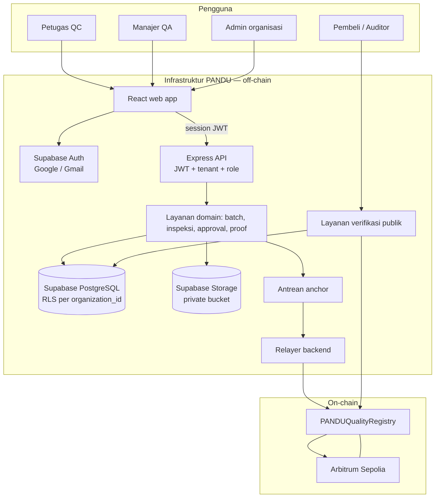
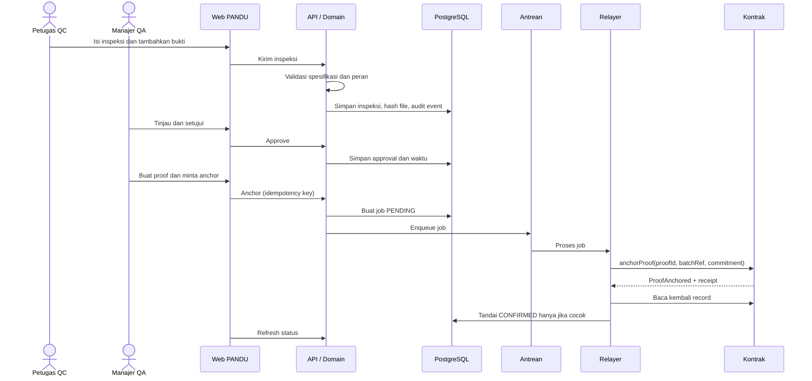
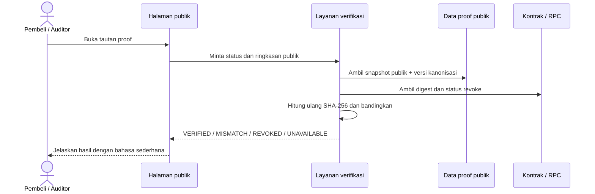
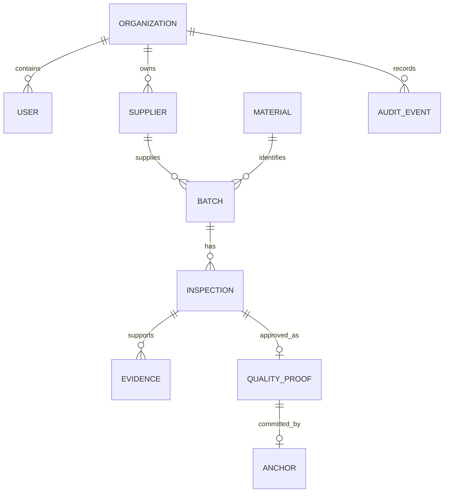
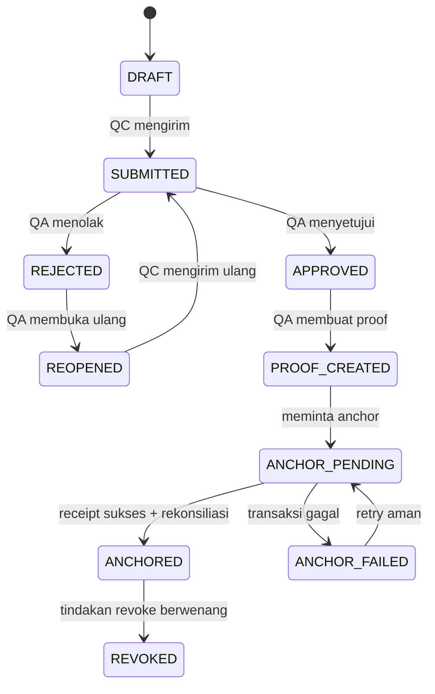
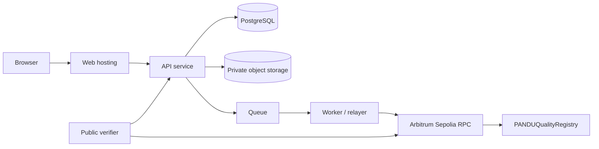

# PANDU — Master Product & Technical Blueprint

**Versi:** 2.0  
**Tanggal:** 8 Oktober 2026  
**Status:** Baseline produk dan arsitektur MVP  
**Produk:** Sistem pencatatan PANDU dan verifikasi proof batch industri  
**Jaringan prototipe:** Arbitrum Sepolia  
**Dokumen turunan:** [PRD v2.0](PANDU_PRD_v2.0.md) · [Prototype Design v2.0](PANDU_Prototype_Design_v2.0.md) · [Smart Contract v1.0](PANDU_Smart_Contract_v1.0.md)

## 1. Ringkasan

PANDU mencatat proses pemeriksaan kualitas sebuah batch bahan, memisahkan tugas pemeriksa dan penyetuju, lalu membuat **Quality Proof** yang bisa diverifikasi pihak luar. Catatan lengkap dan dokumen tetap berada di aplikasi; blockchain menyimpan satu komitmen kriptografis dan status pencabutan.

**Janji produk:** “Kami membantu Anda memeriksa apakah bukti PANDU yang diterima sama dengan bukti yang disetujui dan direkam sebelumnya.” PANDU tidak membuktikan sendiri bahwa bahan fisik asli, hasil ukur jujur, atau pemasok memenuhi standar.

## 2. Konteks, masalah, dan pengguna

Dokumen PANDU sering berpindah lewat email, spreadsheet, dan PDF. Ketika bukti sampai ke pembeli, sulit memastikan dokumen itu masih sama dengan versi yang disetujui. PANDU memberikan satu catatan proses dan cara pemeriksaan publik yang tidak bergantung hanya pada database pemasok.

Pengguna utama: QC Inspector, QA Manager, Buyer/Auditor, Admin Organisasi, serta layanan Relayer. Pengguna operasional tidak perlu wallet atau istilah blockchain untuk menyelesaikan pekerjaannya.

## 3. Prinsip arsitektur

1. **Aplikasi adalah sistem operasi PANDU.** Database aplikasi menyimpan data operasional yang dapat berubah sesuai audit dan hak akses.
2. **Blockchain adalah lapisan pemeriksaan independen.** Kontrak menyimpan komitmen digest dan status revoke, bukan ERP.
3. **Privat secara default.** File, catatan, harga, PII, dan data organisasi tidak ditaruh di chain.
4. **Tidak ada klaim berlebihan.** Hash membuktikan integritas representasi yang di-anchor; bukan kebenaran fisik.
5. **Login untuk semua tim, wallet opsional.** Google/Gmail adalah login utama; MetaMask dihubungkan setelah login melalui SIWE. Pengguna tidak menandatangani transaksi; backend relayer melakukan anchor dengan kunci server.
6. **Multi-tenant secara default.** Data setiap organisasi memiliki `organization_id`, membership, role, dan kebijakan RLS sendiri. Industri hanya konfigurasi profile inspeksi, bukan aplikasi atau kontrak terpisah.
7. **Status transaksi berdasarkan bukti.** `CONFIRMED` hanya setelah receipt sukses dan pembacaan kontrak cocok.
8. **Riwayat tidak dihapus.** Proof dicabut, tidak dihapus diam-diam.
9. **Sederhana untuk pengguna awam.** Istilah teknis hanya muncul dalam detail lanjutan.

## 4. Batas MVP

### Termasuk

- Batch manual, inspeksi pengukuran, hasil otomatis, bukti privat, persetujuan QA.
- Snapshot Quality Proof, digest SHA-256 kanonis, anchor Arbitrum Sepolia.
- Halaman pemeriksaan publik tanpa akun/wallet.
- Status valid, berubah, dicabut, menunggu, gagal/tidak tersedia.
- Audit log untuk perubahan inti.

### Tidak termasuk

- Token kepemilikan aset, perdagangan komoditas, marketplace, escrow/pinjaman.
- Pembayaran, mainnet, integrasi ERP eksternal, atau klaim kepatuhan produksi.
- Bukti sensor/oracle otomatis tentang kondisi fisik barang.
- Menyimpan data pribadi atau dokumen mentah secara on-chain.

## 5. Diagram arsitektur

### 5.1 Batas sistem

**Target multi-tenant:** Supabase Auth untuk login Google/Gmail; MetaMask hanya dapat ditautkan sesudah masuk untuk membuktikan kepemilikan address. Supabase Postgres dan private Storage menyimpan data tenant. API memvalidasi JWT, memilih membership aktif, dan memeriksa role. Pembeli/auditor publik memakai verifier terbatas, bukan akses langsung ke tabel tenant.

**Yang benar-benar on-chain:** kontrak `PANDUQualityRegistry` dan jaringan EVM yang dikonfigurasi. Relayer, antrean, UI, database, dan object storage adalah komponen off-chain. Pembeli/auditor adalah pengguna aplikasi, bukan komponen kontrak.

### 5.2 Urutan persetujuan dan anchor

### 5.3 Verifikasi publik

### 5.4 Komponen dan kepemilikan data

| Komponen | Menyimpan / melakukan | Batas keamanan |
|---|---|---|
| React web app | Form QC/QA, workspace tenant, pengaturan wallet, halaman publik | Tidak memegang private key relayer atau service role |
| Supabase Auth | Akun Google/Gmail dan provider enterprise | MetaMask bukan login utama; wallet link bukan role |
| API/domain | Validasi JWT, tenant scope, role checks, workflow | Jangan percaya organization/role dari browser |
| Supabase PostgreSQL | Master data, inspeksi, metadata proof, audit, status job | RLS aktif pada semua tabel tenant |
| Supabase Storage | File bukti privat dan versi | Bucket private, policies per organization UUID |
| Queue + relayer | Mengirim anchor/revoke dan rekonsiliasi | Kunci server-only, idempotensi, retry terkontrol |
| Kontrak | proofId, batchRef, commitment, attester, timestamp, revoke | Tidak menyimpan berkas atau PII |
| Verifier | Menghitung ulang dan membandingkan digest | Publik hanya menerima kolom allowlist |

## 6. Model domain dan status

State proof dan state transaksi anchor disimpan terpisah. `APPROVED` tidak sama dengan `ANCHORED`.

## 7. Kanonisasi dan definisi hash

PANDU harus membedakan tiga nilai berikut agar istilah konsisten:

1. **Hash file**: SHA-256 atas byte persis satu berkas. Dipakai untuk mendeteksi perubahan file; disimpan off-chain.
2. **Representasi proof kanonis**: snapshot JSON publik yang disetujui, versi 1, dengan urutan field tetap.
3. **Komitmen proof**: SHA-256 atas byte UTF-8 representasi kanonis; nilai 32-byte ini yang ditulis ke kontrak v1.

Nama ABI legacy `evidenceHash` dipertahankan demi kompatibilitas pada baseline hackathon, tetapi secara semantik nilainya adalah **komitmen proof kanonis**, bukan hash satu file. UI menyebutnya “Komitmen proof”. Implementasi baru boleh mengganti nama parameter menjadi `commitment` hanya melalui versi ABI/deployment baru.

Aturan kanonisasi v1:

- UTF-8; JSON tanpa whitespace yang tidak bermakna.
- Urutan properti eksplisit dalam schema, bukan urutan input user.
- String dinormalisasi sesuai aturan schema; timestamp UTC ISO-8601 dengan milidetik.
- Angka direpresentasikan sebagai string desimal sesuai presisi field; tidak memakai format lokal.
- Daftar hash berkas diurutkan deterministik sebelum masuk snapshot.
- Null dihilangkan kecuali schema mengharuskannya; boolean JSON standar.
- `canonicalizationVersion` selalu disertakan.
- Perubahan schema/serializer yang memengaruhi byte menghasilkan versi baru; jangan menafsirkan ulang proof v1.
- Backend menghitung SHA-256; Solidity menerima `bytes32` digest mentah dan tidak meng-hash ulang dengan keccak256.

Data pada snapshot publik harus merupakan allowlist yang aman dibagikan. Jika nama pihak bersifat rahasia, gunakan label/reference publik yang disetujui organisasi.

## 8. Kontrak API konseptual

| Endpoint | Tujuan |
|---|---|
| `GET /api/batches` | Daftar batch tenant |
| `POST /api/batches` | Buat batch manual |
| `GET /api/batches/:id` | Detail batch terotorisasi |
| `POST /api/inspections` | Buat inspeksi; server menentukan PASS/FAIL |
| `POST /api/inspections/:id/submit` | Kirim inspeksi untuk QA |
| `POST /api/inspections/:id/approve` | Setujui sebagai QA berwenang |
| `POST /api/inspections/:id/reject` | Tolak dengan alasan |
| `POST /api/evidence` | Unggah file privat dan hitung hash |
| `POST /api/quality-proofs` | Buat snapshot proof setelah approval |
| `POST /api/quality-proofs/:id/anchor` | Buat job anchor idempoten |
| `POST /api/quality-proofs/:id/revoke` | Cabut proof dan kirim transaksi berwenang |
| `GET /api/anchors/:id/status` | Status job/receipt/reconciliation |
| `GET /api/public/proofs/:proofId` | Ringkasan aman + hasil verifikasi publik |

Semua mutasi tervalidasi sisi server, dibatasi organisasi, dan menghasilkan audit event. Endpoint publik tidak mengembalikan URL objek privat.

## 9. Keamanan dan privasi

- Tenant scope berasal dari sesi/token tervalidasi di server; jangan percaya `organization_id` dari klien.
- Terapkan RBAC untuk setiap mutasi. QC dan QA harus menjadi pemisahan tugas, setidaknya QC tidak boleh menyetujui inspeksi sendiri.
- Simpan password dengan hashing kuat dan session cookie aman; gunakan perlindungan CSRF sesuai pola auth.
- Validasi file: ukuran, ekstensi, MIME aktual, nama storage acak; cegah file executable dan path traversal.
- Batasi akses file dengan pemeriksaan kepemilikan tenant dan URL berumur pendek bila diperlukan.
- Kunci relayer berada di secret manager/env server-only; tidak pernah dikirim ke bundle frontend atau log.
- Anchor/revoke memerlukan idempotency key, unique proof ID, pembatasan retry, dan rekonsiliasi receipt.
- Audit log append-only secara aplikasi; jangan hard-delete proof yang pernah dibuat.
- Data publik berasal dari allowlist dan ditinjau pemilik data.
- Kontrak menggunakan role minimal, event, dan pemeriksaan reentrancy/overflow standar. Tidak menerima token atau dana.

## 10. Kebutuhan nonfungsional

- **Keandalan:** kegagalan RPC tidak menghilangkan proof off-chain atau mengubah status menjadi sukses.
- **Keterlacakan:** setiap aksi perubahan mempunyai aktor, waktu UTC, target, dan hasil.
- **Aksesibilitas:** label teks untuk status, keyboard, fokus terlihat, kontras terbaca, reduced motion.
- **Responsif:** operasi utama nyaman pada desktop; halaman publik dapat digunakan di ponsel.
- **Keteramatan:** log terstruktur tanpa secret/PII; metrik antrean, RPC, receipt, dan rekonsiliasi.
- **Bahasa:** antarmuka MVP berbahasa Indonesia sederhana, istilah teknis dijelaskan bila muncul.

## 11. Stack dan deployment MVP

Target alpha multi-organisasi: React frontend, Supabase Auth (Google/Gmail utama), Express API/domain service, Supabase PostgreSQL dengan RLS, Supabase Storage private bucket, worker queue/relayer, Solidity `PANDUQualityRegistry`, Arbitrum Sepolia. MetaMask dapat dihubungkan setelah login Google melalui challenge SIWE off-chain. Detail tabel, policy, dan rollout ada di [Arsitektur Multi-Industri v1.0](PANDU_Multi_Industry_Architecture_v1.0.md).

**Status implementasi lokal:** aplikasi saat ini masih memakai state JSON satu organisasi dan belum menjalankan Supabase Auth, PostgreSQL/RLS, atau tenant isolation. Fondasi SQL ada di `supabase/migrations/`, belum diterapkan. Jangan paparkan server demo lokal ke internet atau gunakan beberapa perusahaan sebelum fase migrasi selesai.

Environment terpisah: local/test, Sepolia demo, dan kelak produksi. Alamat kontrak, chain ID, confirmations, explorer URL, dan mode mock harus berupa konfigurasi eksplisit.

## 12. Demo hackathon

1. Buka `ST-2026-001`, pelat SS400 dari PT Baja Nusantara.
2. Tampilkan tebal aktual 10,0 mm dalam batas 9,5–10,5 mm.
3. Petugas QC mengirim hasil dan bukti.
4. QA menyetujui, lalu membuat Quality Proof.
5. Minta anchor dan buka transaksi pada explorer setelah dikonfirmasi.
6. Buka tautan publik tanpa wallet; tampilkan “Bukti cocok”.
7. Jalankan simulasi perubahan snapshot atau pencabutan yang diberi label demo; tampilkan arti “Bukti berubah” atau “Bukti dicabut”.

Demo boleh punya adapter lokal untuk latihan, tetapi setiap state mock harus dilabeli **SIMULASI**. Demo penjurian menggunakan kontrak dan transaksi nyata bila jaringan tersedia.

## 13. Keputusan arsitektur

| ID | Keputusan | Alasan |
|---|---|---|
| ADR-001 | Data operasional tetap off-chain; kontrak hanya commitment dan revoke | Privasi, biaya rendah, dan tanggung jawab jelas |
| ADR-002 | User tidak menandatangani transaksi; relayer server melakukan anchor | UX cocok bagi operator non-crypto |
| ADR-003 | `evidenceHash` ABI v1 berarti digest proof kanonis | Menjaga ABI baseline sambil memberi istilah UI yang jelas |
| ADR-004 | Public verification tidak membutuhkan berkas privat | Auditor dapat memeriksa komitmen tanpa membuka dokumen rahasia |
| ADR-005 | Konfirmasi memerlukan receipt sukses plus pembacaan kontrak | Mencegah status UI yang tidak cocok dengan jaringan |
| ADR-006 | Testnet untuk MVP; tidak ada token pembayaran | Mengurangi lingkup dan risiko demo |
| ADR-007 | Supabase Auth Google/Gmail sebagai login utama; email OTP fallback | Operator bisa login tanpa wallet dan memiliki jalur pemulihan akun |
| ADR-008 | MetaMask dihubungkan setelah login lewat challenge SIWE; tidak memberi role | Membuktikan kontrol address tanpa membuat wallet sebagai identitas perusahaan |
| ADR-009 | Supabase PostgreSQL + RLS, satu tenant per organization_id | Isolasi data lintas perusahaan diterapkan dekat data dan dapat diverifikasi |
| ADR-010 | Industri memakai quality profile dan snapshot versi aturan | Satu produk dapat dikonfigurasi untuk proses industri berbeda tanpa fork kontrak |

## 14. Rencana implementasi berurutan

1. Bekukan proof schema dan aturan kanonisasi v1.
2. Implementasi database, auth/tenant, RBAC, audit event, dan alur batch-inspeksi.
3. Implementasi penyimpanan privat dan SHA-256 file di server.
4. Implementasi QA approval serta proof generator deterministik.
5. Deploy kontrak ke Arbitrum Sepolia; simpan ABI dan konfigurasi alamat.
6. Implementasi antrean/relayer idempoten dan rekonsiliasi.
7. Implementasi halaman publik, status unavailable, dan tautan explorer.
8. Poles demo data dan validasi semua state penting.

## 15. Referensi dokumen

- [PRD v2.0](PANDU_PRD_v2.0.md) — kebutuhan produk dan acceptance criteria.
- [Prototype Design v2.0](PANDU_Prototype_Design_v2.0.md) — informasi layar, bahasa, warna, serta sumber React Bits.
- [Smart Contract v1.0](PANDU_Smart_Contract_v1.0.md) — ABI, invariant, lifecycle, dan deployment.
- Dokumen v1.0/v1.5 terdahulu disimpan sebagai arsip historis; bila berbeda, dokumen v2.0 ini menjadi acuan MVP.
