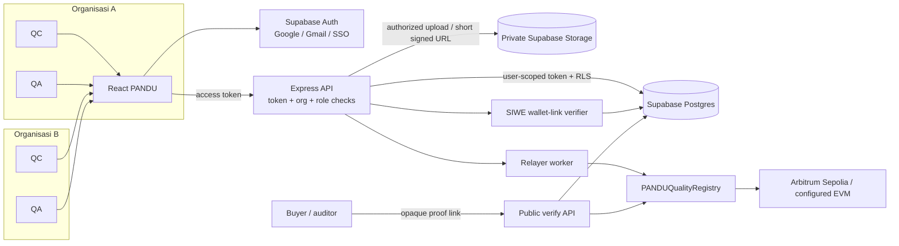

# PANDU — Arsitektur Multi-Industri dan Akun Organisasi

**Versi:** 1.0  
**Status:** Integrasi frontend/backend ditulis; migration belum diterapkan dan provider Google masih nonaktif  
**Tujuan:** Menjelaskan siapa yang login, bagaimana organisasi dipisahkan, tempat data disimpan, dan bagaimana wallet berhubungan dengan proof.

## Keputusan singkat

1. **Database: Supabase Postgres.** Gunakan satu project Supabase untuk Auth, Postgres, dan private Storage pada alpha. Isolasi organisasi tetap wajib melalui `organization_id`, membership, dan Row Level Security (RLS).
2. **Login utama: Google OAuth dengan akun Gmail.** Gunakan Supabase Auth Google provider. Email OTP menjadi opsi cadangan; SSO perusahaan dapat diaktifkan saat onboarding enterprise.
3. **MetaMask dihubungkan setelah login.** Pengguna login terlebih dahulu dengan Google, lalu secara opsional menghubungkan wallet dari pengaturan akun. Backend memverifikasi pesan SIWE untuk membuktikan kontrol atas alamat; tidak ada transaksi atau gas.
4. **Wallet tidak diperlukan untuk bekerja atau menyetujui inspeksi.** Approval dilakukan oleh pengguna terautentikasi dengan role organisasi. Backend relayer tetap mengirim anchor/revoke; private key relayer tidak pernah berada di browser.
5. **Satu pengguna dapat menjadi anggota beberapa organisasi.** Setiap sesi memilih organisasi aktif; server memeriksa membership dan role untuk setiap permintaan.
6. **Proof publik tidak membuka akses ke tenant.** Verifikasi publik memakai token acak yang sulit ditebak dan hanya mengembalikan snapshot allowlist. Tabel privat dan file bukti tidak dapat dibaca publik.

## Status project yang sudah diperiksa

Pada 9 Oktober 2026, Supabase Auth endpoint project merespons dengan URL dan publishable key yang diberikan. Auth Settings menunjukkan provider Google `false`; REST `organizations` mengembalikan 404, sehingga migration belum diterapkan atau schema cache belum diperbarui. Backend belum mempunyai `SUPABASE_SERVICE_ROLE_KEY`. Karena itu Google login, workspace database, SIWE server endpoint, proof persistence, dan verifikasi Supabase belum dapat dites end-to-end terhadap project.

## Apakah perlu login dengan MetaMask?

**MetaMask dihubungkan setelah pengguna masuk dengan Gmail/Google Workspace.** Tombol Google mengalihkan pengguna ke halaman resmi Google; PANDU tidak meminta atau menyimpan password Gmail. Identitas kerja tetap akun Google/SSO yang dikelola organisasi dan punya jalur pemulihan. Pengguna tidak perlu memasang MetaMask, menyimpan seed phrase, punya ETH, atau menandatangani transaksi untuk memakai PANDU.

Setelah login, tombol **Hubungkan MetaMask** memulai challenge SIWE/EIP-4361 dari backend. Pengguna menandatangani pesan yang menyebut domain PANDU, address, nonce sekali pakai, waktu kedaluwarsa, dan kalimat “Hubungkan wallet ke akun PANDU. Ini bukan transaksi.” Backend memvalidasi signature dan nonce lalu mengikat address ke `auth.users.id` Gmail yang sedang login. Ini pesan off-chain, tidak ada transaksi atau gas. Supabase menyediakan login wallet Web3 native, tetapi PANDU tidak memakai wallet sebagai metode login utama karena pengguna sudah memilih Gmail terlebih dahulu.

Alamat wallet membuktikan kontrol atas kunci saat ditautkan, **bukan** identitas hukum perusahaan, jabatan karyawan, atau kewenangan QA. Perubahan atau pelepasan wallet memerlukan sesi Gmail terautentikasi. Role organisasi tetap berasal dari undangan/admin.

### Pengalaman pengguna

```text
Semua pengguna
Masuk dengan Google / Gmail (Supabase Auth)
                  ↓
        Pilih organisasi yang diundang
                  ↓
       Server periksa membership + role
                  ↓
       QC / QA memakai PANDU tanpa wallet
                  ↓ opsional, dari pengaturan akun
  Hubungkan MetaMask → tanda tangani SIWE message
                  ↓
        Backend verifikasi nonce + signature
                  ↓
       Wallet tersimpan sebagai identitas tertaut
```

### Aturan login dan pemulihan akun

- Google OAuth/Gmail menjadi tombol utama. Email OTP/magic link adalah fallback; SAML SSO disediakan untuk pelanggan perusahaan sesuai kebutuhan.
- Google OAuth mendukung akun Gmail dan akun Google Workspace. Client ID/secret dikonfigurasi pada provider Google di dashboard Supabase; OAuth secret jangan ditaruh di frontend atau dikirim lewat chat.
- Wallet linking memakai format SIWE dengan domain yang benar, nonce satu kali, masa berlaku singkat, `chain-id`, dan signature diverifikasi server-side. Challenge diikat ke user Gmail yang sedang login.
- Tampilkan dengan jelas bahwa MetaMask diminta menandatangani **pesan untuk menghubungkan alamat**, bukan transaksi. PANDU tidak meminta seed phrase atau private key.
- Gmail tetap menjadi metode login dan pemulihan akun bila pengguna kehilangan wallet. Pengguna dapat melepas wallet setelah autentikasi ulang.
- Jangan otomatis memberi akses ke organisasi hanya karena email domain sama, address wallet tertentu, atau pengguna berhasil login. Admin organisasi mengundang/menyetujui membership.
- Login sukses hanya mengidentifikasi pengguna. Role `QC`, `QA`, `admin`, atau `auditor` berasal dari membership organisasi yang disetujui, bukan klaim dari browser atau user metadata.

## Pilihan database: Supabase

Supabase cocok untuk alpha karena Auth, managed PostgreSQL, RLS, dan object storage berada dalam satu platform. RLS harus aktif pada semua tabel tenant. Kunci `service_role` melewati RLS, sehingga hanya boleh berada di backend/worker dan tidak boleh masuk ke frontend, file publik, atau log.

### Komponen target

| Komponen | Pilihan | Fungsi |
|---|---|---|
| Web | React + TypeScript | UI tenant-aware; session login Supabase; tidak memegang kunci relayer |
| Identity | Supabase Auth | Google OAuth/Gmail, email OTP fallback, dan OIDC/SAML SSO bila diperlukan |
| API | Express (lanjutan dari MVP) | Validasi token; membership/role check; QC→QA workflow; file hashing; proof canonicalization; relayer |
| Database | Supabase PostgreSQL | Organisasi, anggota, supplier, material, batch, inspeksi, proof metadata, dan audit |
| File | Supabase Storage private bucket | PDF/foto bukti dengan path yang memuat ID organisasi; akses berbasis Storage RLS atau URL signed singkat |
| Worker/relayer | Backend terpisah dari browser | Anchor/revoke, retry, rekonsiliasi receipt, dan secret wallet |
| Kontrak | `PANDUQualityRegistry` | Hanya referensi/digest proof dan status revoke; tidak menyimpan PII atau file |
| Verifikasi publik | Route API read-only | Mencari proof berdasarkan public token; membandingkan snapshot/chain tanpa membuka database tenant |



Supabase RLS menjadi pertahanan tambahan, bukan pengganti otorisasi API. API tidak boleh percaya `organization_id`, `user_id`, atau `role` yang dikirim browser; ambil identitas dari token tervalidasi dan membership aktif di database. Untuk query database normal, teruskan JWT pengguna agar RLS berlaku. Worker dapat memakai secret `service_role` untuk job internal yang sah, dengan audit dan scope organisasi yang berasal dari job tersimpan.

## Organisasi dan role

Satu akun identitas dapat menjadi anggota banyak organisasi. Organisasi memiliki data sendiri; nama industri hanya metadata konfigurasi, bukan batas keamanan.

| Role membership | Hak utama |
|---|---|
| `owner` | Mengatur organisasi dan menunjuk admin; tidak otomatis menjadi QA untuk semua inspeksi |
| `admin` | Mengundang/nonaktifkan anggota, mengelola master data dan konfigurasi |
| `qc` | Membuat batch/inspeksi, unggah bukti, kirim inspeksi untuk review |
| `qa` | Meninjau, menyetujui, atau menolak inspeksi; membuat proof setelah approval |
| `auditor` | Membaca catatan yang diberi akses dalam organisasi; tidak mengubah atau approve |

Pemisahan tugas diverifikasi server: pembuat inspeksi tidak boleh menyetujui inspeksi yang sama. Buyer/pihak luar tidak perlu menjadi anggota tenant; mereka hanya melihat field yang memang disetujui pemilik proof untuk halaman publik.

## Cara mendukung banyak industri

Jangan membuat fork aplikasi/kontrak untuk tiap sektor. Pakai satu alur inti dan profile konfigurasi organisasi:

```text
Organisasi → profile inspeksi → jenis pengukuran + unit + batas + versi aturan
Batch → inspeksi memakai snapshot aturan → QC kirim → QA setujui
→ proof menyimpan snapshot yang disetujui → anchor komitmen → verifikasi
```

- `industry_key` membantu onboarding dan template awal, misalnya `metals`, `food`, `construction`, `agriculture`, atau `logistics`. Nilai ini tidak menentukan kewenangan akses.
- Tiap organisasi mengatur supplier, material/produk, lokasi, jenis tes, satuan, toleransi, dan format bukti yang relevan.
- Snapshot spesifikasi dan versi template disalin ke inspeksi saat dibuat. Perubahan standar besok tidak boleh mengubah proof historis.
- Gunakan JSONB untuk atribut khusus industri yang berubah-ubah; field inti seperti tenant, status, aktor, nilai terukur, waktu, dan referensi file tetap kolom bertipe jelas agar bisa divalidasi dan diindeks.
- Jangan menyatakan template PANDU adalah sertifikasi atau standar resmi. Organisasi bertanggung jawab memilih spesifikasi yang berlaku.

## Batas tabel dan file

| Entitas | Isi utama | Kebijakan akses |
|---|---|---|
| `organizations` | Profil dan `industry_key` organisasi | Anggota aktif; edit owner/admin |
| `organization_members` | `user_id`, `organization_id`, role, status | Anggota melihat membership sendiri; admin mengelola anggota |
| `user_wallets` | `user_id`, address EVM, chain saat verifikasi, `verified_at` | Hanya pengguna itu dan endpoint akun tepercaya; satu address tidak boleh tertaut ke dua user |
| `wallet_link_challenges` | Hash nonce, user Gmail, domain, chain ID, expiry, waktu konsumsi | Backend only; nonce sekali pakai untuk mencegah replay |
| `quality_profiles` | Template inspeksi dan versi aturan | Hanya tenant terkait; admin mengedit |
| `suppliers`, `materials`, `batches` | Master dan data batch | Hanya anggota tenant; mutasi mengikuti role |
| `inspections` | Pengukuran, spesifikasi snapshot, status, QC, QA | Hanya anggota tenant; QC submit, QA review/approve |
| `evidence_files` | Nama aman, tipe, ukuran, SHA-256, object path | Metadata tenant-only; bytes di bucket private |
| `quality_proofs` | Canonicalization version, allowlisted public snapshot, commitment, chain status, random public token hash | Anggota tenant membaca; publik hanya melalui verifier API |
| `audit_events` | Aktor, aksi, objek, waktu, metadata terbatas | Append-only; tenant admin/auditor dapat membaca sesuai kebijakan |
| `anchor_jobs` | Job key, proof, retry, tx hash, state | Worker/backend only |

File berada di bucket private `quality-evidence`, dengan object path berawalan UUID organisasi, contoh `{organization_uuid}/{batch_uuid}/{random_file_uuid}`. Browser tidak menerima key service role. Endpoint API memeriksa membership sebelum mengeluarkan URL bertanda tangan berumur pendek. Public proof tidak memberikan akses ke file privat.

## Public proof dan privacy

- Generate `public_token` acak ber-entropi tinggi saat proof diterbitkan. Simpan hanya hash token pada database; link berisi token yang tidak dapat ditebak, bukan ID urut seperti `000001`.
- Halaman verifikasi hanya mendapat snapshot allowlist, status anchor/revoke, chain, waktu, dan link explorer yang dibutuhkan. Jangan mengirim catatan internal, email anggota, alamat storage, atau file privat.
- Data yang ditulis ke chain minimum: random proof ID, random batch reference, SHA-256 commitment, attester, timestamp, revoke state. Jangan gunakan hash sederhana atas nomor batch berurutan karena dapat ditebak.
- Atur masa berlaku/revoke link publik bila pemilik butuh kontrol berbagi. Revoke proof di kontrak tidak otomatis menghapus data privat dari database atau backup.

## Implementasi sekarang vs target multi-tenant

| Area | Kode yang ada | Target multi-tenant |
|---|---|---|
| Login | Tombol OAuth terhubung ke Supabase JS; Google provider project masih off | Google/Gmail aktif; MetaMask opsional setelah login via SIWE |
| Tenant | UI/query multi-org dan RLS tersedia di migration; tabel project belum ada | Banyak organisasi, membership, pemilih aktif, isolation diverifikasi |
| Database | Supabase client dipakai workspace; backend service-role belum dikonfigurasi | Supabase Postgres + migration + RLS terpasang dan diuji |
| Evidence | UI memakai private bucket dan metadata tenant; bucket/migration belum tersedia | Bucket private, role/tenant checks, URL singkat |
| Role | Workflow memakai RPC dari migration yang belum diterapkan | Role membership server-side + RLS + pemisahan QC/QA |
| Proof public | Endpoint service-role tersedia, menunggu migration/key | Public token acak, snapshot allowlist persisten, chain proof terverifikasi |
| Relayer/contract | Sepolia default; konfigurasi Arbitrum One ada tetapi belum dideploy | Worker/job persisten, role wallet terpisah, deployment/monitoring per chain |

Kode saat ini belum siap dibuka ke internet atau dipakai beberapa perusahaan. URL browser aktif tetapi migration belum dijalankan, Google provider nonaktif, backend service-role belum dimasukkan, dan isolasi tenant belum dapat dites di project live. SQL tersedia di [migration Supabase](../supabase/migrations/202610090001_multi_tenant_foundation.sql); ikuti [runbook deployment](PANDU_Deployment_Runbook_v1.0.md).

## Urutan implementasi

1. Terapkan migration ke project Supabase lewat SQL Editor dan periksa `organizations`, RLS policies, RPC, serta bucket private.
2. Buat Google OAuth Web Client di Google Cloud, aktifkan provider Google di Supabase, dan atur redirect URL lokal serta URL deploy.
3. Simpan `SUPABASE_SERVICE_ROLE_KEY` pada `backend/.env` lokal atau secret manager server. Jangan menaruhnya di frontend atau Git.
4. Login memakai Google, buat organisasi, tambahkan profile inspeksi, pemasok, material, dan batch. Buat dua akun agar pemisahan QC/QA dapat diperiksa.
5. Uji tenant isolation dengan dua organisasi, termasuk database, RPC, dan object storage. Perbaiki policy bila satu tenant dapat melihat tenant lain.
6. Uji SIWE challenge pada Arbitrum Sepolia dan pastikan wallet hanya menaut ke akun Gmail yang aktif; nonce replay dan wallet duplikat harus ditolak.
7. Jalankan siklus inspeksi, private evidence, QA terpisah, proof, anchor, QR, dan pemeriksaan tanpa login pada Sepolia.
8. Tambahkan unlink wallet dan invitation management sebelum onboarding organisasi eksternal; ini belum tersedia pada UI alpha.
9. Audit kontrak, RLS, dependency, dan operasi sebelum mainnet. Arbitrum One deployment memakai ETH sungguhan dan memiliki pagar environment terpisah.

## Sumber teknis resmi

- [Supabase Auth](https://supabase.com/docs/guides/auth)
- [Supabase Web3 / Ethereum login](https://supabase.com/docs/guides/auth/auth-web3)
- [Supabase Row Level Security](https://supabase.com/docs/guides/database/postgres/row-level-security)
- [Supabase Storage access control](https://supabase.com/docs/guides/storage/security/access-control)
- [EIP-4361 / Sign-In with Ethereum](https://eips.ethereum.org/EIPS/eip-4361)
