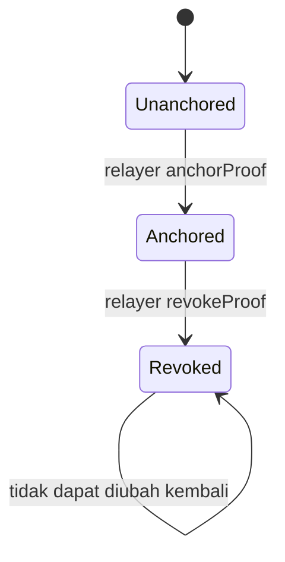
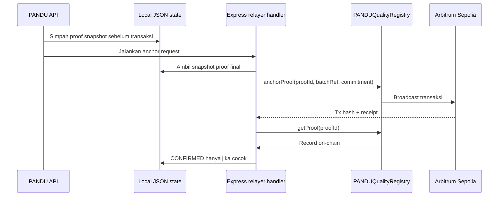

# PANDU — Smart Contract Specification

**Versi:** 1.0  
**Status:** Spesifikasi MVP; bukan audit keamanan  
**Kontrak:** `PANDUQualityRegistry`  
**Jaringan default:** Arbitrum Sepolia (`421614`)  
**Jaringan produksi target:** Arbitrum One (`42161`), belum dideploy  
**Acuan:** [Blueprint](PANDU_ERP_Master_Blueprint_v2.0.md) · [PRD](PANDU_PRD_v2.0.md)

## 1. Tujuan kontrak

Kontrak menyimpan komitmen kriptografis dari satu Quality Proof yang telah disetujui dan memungkinkan relayer berwenang mencabut proof tanpa menghapus catatan historisnya.

Kontrak **bukan** tempat penyimpanan ERP, file, atau token. Kontrak tidak membuktikan kondisi barang fisik, identitas pemasok di dunia nyata, atau bahwa pengukuran awal benar. Ini bukan kontrak investasi/pembayaran.

## 2. Definisi data yang dicatat

Per proof, kontrak menyimpan:

- `proofId`: pengenal stabil dan unik 32-byte.
- `batchRef`: referensi batch berbentuk digest/reference 32-byte; jangan gunakan PII.
- `evidenceHash`: nama ABI v1 yang dipertahankan untuk kompatibilitas. Semantiknya adalah **komitmen proof kanonis** (SHA-256, 32-byte), bukan hash file tunggal.
- `attester`: alamat relayer yang membuat anchor.
- `timestamp`: timestamp blok saat anchor berhasil (nama field ABI saat ini).
- `revoked`: status pencabutan.
- `revokedAt`/`revoker`: informasi pencabutan, bila ada.

Hash file masing-masing disimpan off-chain. Nilai `evidenceHash` pada chain tidak boleh ditampilkan ke pengguna sebagai hash file; UI menyebutnya “Komitmen proof” atau “Sidik jari digital bukti”.

## 3. ABI v1 baseline

```solidity
constructor(address initialRelayer);

function anchorProof(
    bytes32 proofId,
    bytes32 batchRef,
    bytes32 evidenceHash
) external;

function revokeProof(bytes32 proofId) external;

function getProof(bytes32 proofId)
    external
    view
    returns (Proof memory);

event ProofAnchored(
    bytes32 indexed proofId,
    bytes32 indexed batchRef,
    bytes32 evidenceHash,
    address indexed attester,
    uint64 timestamp
);

event ProofRevoked(
    bytes32 indexed proofId,
    address indexed revoker,
    uint64 timestamp
);
```

`Proof` adalah struct ABI berisi field di atas. Implementasi dapat menambahkan getter/status khusus, tetapi tidak boleh mengubah semantik ABI v1 setelah deployment. Perubahan ABI memerlukan versi kontrak baru dan alamat baru.

## 4. Hak akses dan aturan wajib

- Menggunakan kontrol akses berbasis role minimal yang diuji dalam suite Foundry; implementasi saat ini tidak memakai OpenZeppelin `AccessControl`.
- `DEFAULT_ADMIN_ROLE` hanya untuk konfigurasi role; sebaiknya multisig/timelock untuk produksi.
- `RELAYER_ROLE` hanya diberikan ke alamat relayer backend. Hanya role ini dapat anchor dan revoke pada MVP.
- Constructor menerima `initialRelayer`: deployer menerima `DEFAULT_ADMIN_ROLE`, sedangkan alamat relayer menerima `RELAYER_ROLE`. Kedua alamat dapat dipisah. Script demo mengizinkan satu wallet untuk keduanya; jangan gunakan konfigurasi itu sebagai model produksi.
- `proofId` tidak boleh nol dan tidak boleh digunakan lebih dari sekali.
- `batchRef` dan komitmen tidak boleh nol.
- Revoke hanya untuk proof yang sudah ada dan belum dicabut.
- Revoke tidak menghapus atau menimpa digest, waktu, atau attester anchor.
- Fungsi tidak menerima token, ETH, berkas, string arbitrer, atau metadata bebas.
- Kontrak tidak membuat `keccak256(evidenceHash)`. `bytes32` input adalah digest SHA-256 mentah yang dihitung backend.
- Fungsi tidak boleh punya jalur bypass role atau upgrade diam-diam.

## 5. Lifecycle



Status aplikasi lebih rinci daripada state kontrak:

```text
NOT_ANCHORED → PENDING → CONFIRMED
                      ↘ FAILED → PENDING (retry setelah cek chain)
CONFIRMED → REVOKE_PENDING → REVOKED
```

Status `CONFIRMED` harus menunggu receipt transaksi sukses dan membaca kembali record kontrak untuk memeriksa `proofId`, `batchRef`, komitmen, dan revoke state. Pengiriman transaksi saja belum cukup.

## 6. Identitas dan hash

### `proofId`

Konversi backend saat ini adalah `keccak256(UTF8("PANDU:" + proofId))`. ID yang mudah dibaca disimpan di proof snapshot dan ditampilkan di UI. Kontrak menolak ID bytes32 duplikat.

### `batchRef`

Konversi backend saat ini adalah `keccak256(UTF8("PANDU:" + organization + ":" + batchId))`. Jangan memasukkan nomor purchase order atau data sensitif ke referensi publik.

### `evidenceHash` (komitmen proof v1)

1. Bangun snapshot proof publik dari allowlist field yang telah disetujui.
2. Bentuk byte JSON kanonis dengan `canonicalizationVersion = 1` dan urutan field tetap.
3. Hitung SHA-256 atas byte UTF-8 tersebut di backend.
4. Kirim digest mentah 32-byte ke kontrak sebagai `evidenceHash`.
5. Untuk verifikasi, ambil snapshot publik dan versi kanonisasi yang sama, hitung ulang SHA-256, lalu bandingkan dengan record kontrak.

Hash file individual dihitung terpisah atas byte persis file, dan hanya dicantumkan di metadata privat/proof publik bila memang disetujui. Jangan mengandalkan kontrak ini untuk mengecek file privat yang tidak tersedia kepada verifier.

## 7. Arsitektur transaksi MVP saat ini



Private key hanya berada pada backend lokal. MVP memakai JSON state lokal dan handler transaksi sinkron; belum ada antrean persisten atau nonce manager. Sebelum multi-user/produksi, gunakan database transaksional, worker queue, serialisasi nonce per signer, batas gas, timeout, dan retry dengan backoff. Retry harus membaca hash transaksi/record on-chain lebih dulu agar tidak membuat anchor ganda.

## 8. Event dan indexing

Kontrak memancarkan `ProofAnchored` dan `ProofRevoked`. Backend MVP saat ini menunggu receipt satu konfirmasi dan membaca kembali `getProof`; ia belum menjalankan event indexer. Hash transaksi dan block number disimpan pada state lokal untuk ditampilkan di UI. Untuk deployment multi-user, tambahkan indexing/reconciliation persisten dan confirmation policy yang sesuai jaringan; jangan menganggap satu konfirmasi sebagai jaminan finality produksi.

## 9. Kesalahan yang diharapkan

| Kondisi | Perilaku kontrak/backend/UI |
|---|---|
| Proof ID duplikat | Revert; backend rekonsiliasi record lama, bukan membuat anchor kedua |
| Role relayer tidak ada | Revert; status job gagal dengan instruksi admin |
| RPC timeout sebelum diketahui | Tetap `PENDING`/`UNKNOWN`; cari transaksi sebelum retry |
| Receipt gagal | `FAILED`; proof off-chain tetap tersedia |
| Receipt sukses tetapi getter tidak cocok | Jangan tandai confirmed; buka alert rekonsiliasi |
| Proof sudah dicabut | Verifier menampilkan `REVOKED`, walaupun digest masih cocok |
| RPC verifier tidak tersedia | `UNAVAILABLE`, bukan `VERIFIED` |

## 10. Pengujian kontrak

- Role yang tidak sah tidak dapat anchor/revoke.
- Constructor menetapkan admin dan relayer awal; kedua role dapat dipisah dan relayer nol ditolak.
- Admin dapat mengatur role sesuai kebijakan dan akses admin terlindungi.
- ID nol, batchRef nol, digest nol ditolak.
- Proof ID unik; anchor duplikat revert.
- Getter mengembalikan persis parameter serta waktu/attester yang tercatat.
- Hanya proof yang ada dapat dicabut; revoke ganda ditolak atau idempoten sesuai keputusan implementasi (pilih satu dan dokumentasikan).
- Revoke mempertahankan anchor historis dan mengubah status menjadi revoked.
- Event berisi data yang benar.
- Properti fuzz: proof tak berwenang tidak dapat mengubah state; proof yang telah dicabut tak kembali aktif.
- Uji integrasi backend: request berulang tidak menghasilkan dua transaksi/proof, dan status CONFIRMED diverifikasi dari kontrak.

Gunakan compiler Solidity dan versi dependency yang dipin, cek storage/ABI, dan lakukan review statis sebelum deploy. Spesifikasi ini tidak menggantikan audit keamanan.

## 11. Deploy dan verifikasi

### Multi-network policy

- Arbitrum Sepolia adalah default untuk tes integrasi. Set `PANDU_CHAIN=arbitrum-sepolia` dan gunakan alamat registry testnet.
- Arbitrum One tersedia melalui `PANDU_CHAIN=arbitrum-one`; RPC, chain ID, dan explorer diverifikasi oleh backend. Setiap proof menyimpan `chain_id` dan `contract_address`, jadi verifier memilih jaringan asal proof.
- Backend menolak anchor dan revoke mainnet kecuali `ENABLE_MAINNET_ANCHOR=true`. Skrip deploy mainnet memerlukan `DEPLOYER_PRIVATE_KEY` terpisah, `ENABLE_MAINNET_DEPLOYMENT=true`, dan `MAINNET_DEPLOY_CONFIRMATION="I UNDERSTAND THIS USES REAL ETH"`.
- Pagar konfigurasi mengurangi salah jaringan, tetapi bukan persetujuan otomatis memakai mainnet. Selesaikan audit, tes fork, tes tenant/RLS, serta rehearsal testnet sebelum mengaktifkan flag.

Belum ada deployment Arbitrum One atau manifest yang diverifikasi dalam source tree. Kontrak belum diaudit.

1. Pin versi compiler, dependency, optimizer settings, dan commit source.
2. Deploy ke Arbitrum Sepolia dari akun deployer terpisah.
3. Constructor memberi `RELAYER_ROLE` ke alamat yang dipilih. Gunakan `DEPLOYER_PRIVATE_KEY` terpisah untuk admin dan `RELAYER_PRIVATE_KEY` untuk backend; untuk demo lokal, keduanya boleh sama.
4. Simpan chain ID, alamat kontrak, ABI, deployment block, dan explorer URL dalam konfigurasi environment.
5. Verifikasi source contract pada explorer yang mendukung jaringan.
6. Jalankan satu anchor dan revoke demo; cocokkan event, receipt, dan getter.
7. Simpan deployment manifest di repositori tanpa secret.

**Tidak pernah commit:** private key, mnemonic, RPC API secret, atau kredensial explorer.

## 12. Checklist kesiapan

- [ ] ABI dan makna parameter `evidenceHash` didokumentasikan sama di backend/frontend.
- [ ] Digest dibentuk dari proof snapshot kanonis dan diverifikasi dengan test vector.
- [ ] Role relayer tunggal/terbatas dan private key server-only.
- [ ] Duplicate anchor dan retry sudah aman.
- [ ] Revoke tidak menghapus histori.
- [ ] UI menampilkan transaksi nyata atau label simulasi yang jelas.
- [ ] Verifikasi publik menangani mismatch, revoke, dan unavailable.
- [ ] Alamat, chain ID, ABI, serta deployment block tercatat.
