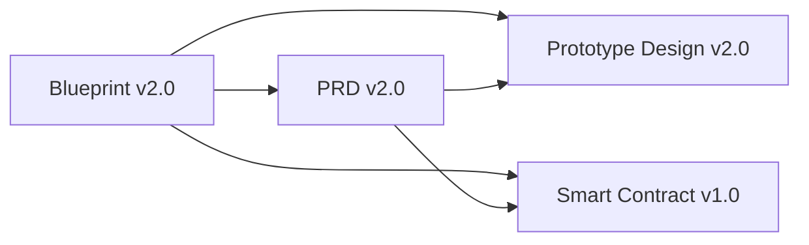

# Dokumentasi PANDU

Dokumen dengan versi tertinggi adalah acuan untuk scope MVP hackathon. Dokumen v1.0/v1.5 terdahulu hanya arsip historis.

## Dokumen utama

1. [Master Product & Technical Blueprint v2.0](PANDU_ERP_Master_Blueprint_v2.0.md) — ruang lingkup, arsitektur, diagram Mermaid, model data, keamanan, keputusan teknis, dan rencana implementasi.
2. [Product Requirements Document v2.0](PANDU_PRD_v2.0.md) — pengguna, alur, kebutuhan produk, acceptance criteria, dan demo.
3. [Prototype & UI Design v2.0](PANDU_Prototype_Design_v2.0.md) — struktur layar, istilah awam, tema warna, responsif, aksesibilitas, serta rekomendasi React Bits.
4. [Smart Contract Specification v1.0](PANDU_Smart_Contract_v1.0.md) — fungsi kontrak, akses, invariant, hashing, lifecycle, deployment, dan verifikasi.

## Hubungan dokumen

Jika implementasi menemukan konflik antara UI, API, dan kontrak, utamakan definisi data dan batas kepercayaan di Blueprint; sinkronkan dokumen turunan sebelum mengubah interface.
